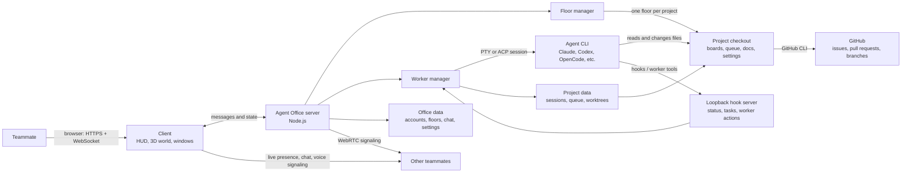
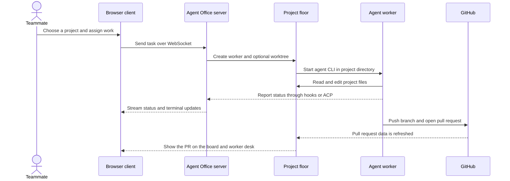

# System overview

Back to the [README](../../README.md). This is the quick map of how a person, a project floor and its workers fit together. For implementation detail, see [How it works](../how-it-works.md) and [Code layout](../code-layout.md).

## Typical task flow

The project agent should keep this page aligned with the actual system when architecture changes. Mermaid source stays ordinary Markdown, so it can also be reviewed and edited in GitHub.
